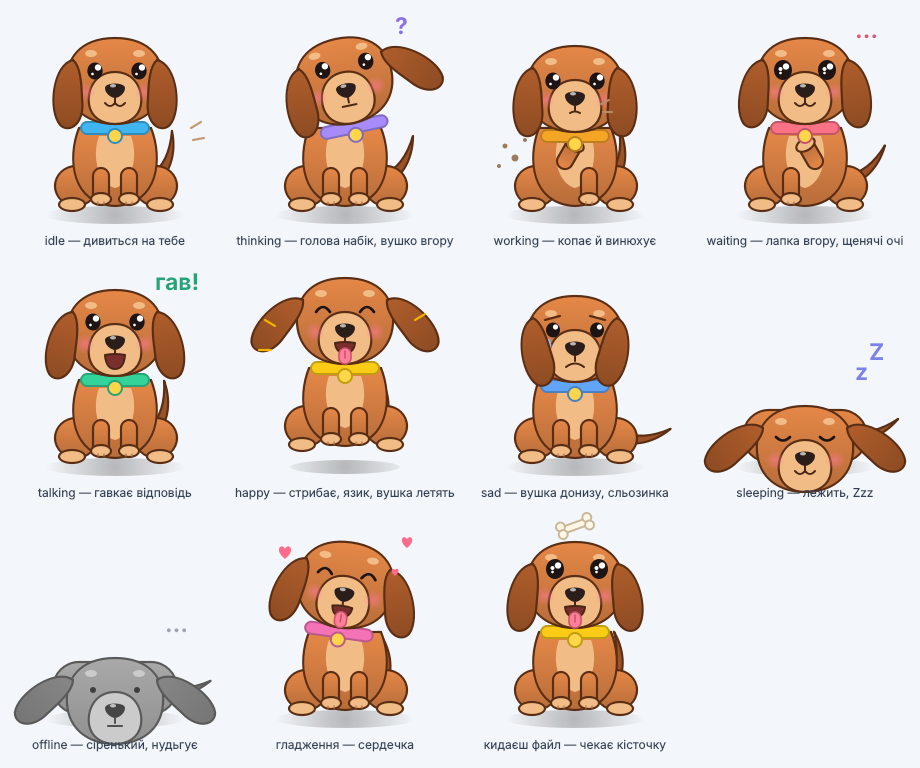

# 🤖 Kru

Власний автономний агент **Kru** на моделі **Qwen3.6-35B-A3B** (llama-server) і милий десктоп-персонаж
(робот або таксик), який живе поверх усіх вікон на Fedora та Windows.

```
┌──────────── Клієнт (Fedora / Windows) ──┐        ┌──────────────── Сервер ────────────────┐
│  🤖 kru-robot (PySide6)                  │  WS    │  kru serve (FastAPI)                   │
│  • завжди поверх вікон, анімації         │◀──────▶│  • цикл агента (LLM ↔ інструменти)     │
│  • клік → поле вводу задачі              │ token  │  • web_search / fetch_url (HTML, PDF)  │
│  • кнопки «Дозволити / Відхилити»        │        │  • файли, shell, Python, зображення    │
└──────────────────────────────────────────┘        │  • пам'ять (за змістом + FTS5), чати   │
                                                    │           │                            │
   kru chat --server ws://… (CLI/REPL) ────────────▶│  Qwen3.6 у llama-server :8085 (Docker) │
                                                    │  ембединги пам'яті :8086 (Docker, CPU) │
                                                    └────────────────────────────────────────┘
```

## Можливості

| Інструмент | Що робить | Підтвердження |
|---|---|---|
| `web_search` | пошук в інтернеті (DuckDuckGo або власний SearXNG), режим новин | — |
| `fetch_url` | читає сторінку чи PDF як текст, з пагінацією | — |
| `deep_research` | глибоке дослідження: кілька запитів, кілька сторінок, нотатки з джерелами → звіт | — |
| `read_file`, `list_dir`, `search_files` | читання та пошук по файлах у workspace | — |
| `write_file`, `edit_file` | створення та редагування файлів | ✅ |
| `run_shell` | команди bash у workspace (з таймаутом) | ✅ (у пісочниці — ні) |
| `run_python` | виконання Python-коду (обчислення, аналіз даних) | ✅ (у пісочниці — ні) |
| `update_plan` | чек-лист великої задачі, видно в панелі персонажа | — |
| `delegate` | доручає підзадачу субагенту з чистим контекстом, повертає лише результат | — |
| `schedule_task`, `list_scheduled`, `cancel_scheduled` | завдання на конкретний час, одноразово чи з повтором | — |
| `send_telegram` | надсилає повідомлення тобі в Telegram | — |
| `remember`, `recall`, `forget` | довготривала пам'ять між чатами, пошук за змістом | — |
| `current_datetime` | поточні дата й час | — |

- **Пам'ять.**
  - Агент сам запам'ятовує важливе: що ти розповідаєш про себе, свої вподобання, людей, плани,
    проєкти, рішення. У чаті з'являється рядок «🧠 Запам'ятав: …», його видно, навіть коли дії агента приховано.
    Паролі й токени він не зберігає. Щоб прибрати запис, скажи «забудь, що …».
  - Пам'ять шукається **за змістом**, а не лише за словами: «що я казав про відпустку?» знайде
    «влітку їду на море». Для цього `deploy/model.sh start` запускає маленьку модель ембедингів
    (Qwen3-Embedding 0.6B, ~0.6 ГБ, лише CPU — відеопам'ять не займає). Без неї пошук іде за словами.
  - Перед кожною задачею агент сам підтягує доречні спогади.
  - Дублікати не зберігаються. Якщо новий факт схожий на старий (наприклад, «тепер п'ю чай»), агент
    бачить обидва й прибирає застарілий.
- **Довгі розмови не обрізаються наосліп.** Коли чат перестає влазити в контекст моделі, найстаріша
  частина стискається в підсумок: цілі, факти, рішення, файли, незавершені справи. Модель бачить
  цей підсумок і свіжі повідомлення. Сам чат зберігається повністю. Вимкнути: `KRU_SUMMARIZE=false`.
- **Чати зберігаються автоматично** на сервері — після кожного повідомлення і кожного кроку агента,
  тож збій чи раптове вимкнення ПК нічого не губить. Непотрібні чати можна видалити.
- **Великі задачі — за планом.** Якщо задача має кілька різних кроків (зібрати дані → порахувати →
  написати звіт), агент спершу складає план і відмічає кроки. У панелі це чек-лист «📋 План · 1/3»
  з позначками ☐ / ⏳ / ✅. План зберігається з чатом. Якщо задачу не завершено, скажи «продовжуй»:
  агент бачить, на якому кроці зупинився. З планом агенту дається більше кроків (~8 на пункт, до 150).
- **Субагенти.** Самодостатню підзадачу, наприклад «прочитай ці 5 файлів і випиши…», агент може
  доручити субагенту з чистим контекстом. Назад приходить тільки результат, тож основна розмова
  не засмічується сирими даними. Дії субагента видно в стрічці як «↳ 🔧 …». Небезпечні дії
  субагента так само чекають на твій дозвіл. Ліміт кроків субагента — `KRU_SUB_MAX_STEPS` (типово 20).
- **Розрив зв'язку не зупиняє задачу.** Якщо мережа (NetBird, Wi-Fi) пропала посеред роботи, агент
  доробляє задачу на сервері. Персонаж пише «📡 Зв'язок втрачено — задача продовжується…». Після
  перепідключення чат відкривається знову з усім, що агент встиг зробити, і далі показує хід роботи.
  Запит на дозвіл, що висів під час розриву, з'явиться знову: на відповідь є 10 хвилин.
- **Кілька користувачів.** У кожного свій токен, а отже свої чати, пам'ять і робоча тека (див. [1.5](#15-користувачі)).
- **Безпека.** Небезпечні дії виконуються тільки після явного дозволу. Файлові операції обмежені робочою директорією `KRU_WORKSPACE`. Доступ до сервера захищений токеном.
- **Дозволи без зайвих запитів.** Коли агент робить щось довге (наприклад, перекладає книгу частинами),
  постійні запити на запис файлів можна прибрати двома способами:
  - кнопка **«До кінця задачі»** у запиті на запис: решту записів у цій задачі агент робить без питань;
  - галочка в налаштуваннях персонажа **«Запис файлів у робочій теці — без запиту»**: діє завжди.

  В обох випадках це стосується лише `write_file` / `edit_file` і лише файлів усередині робочої теки агента.
  Перед кожним перезаписом чи зміною стара версія файлу копіюється в `.kru-backup/<дата-час>/` (копії живуть
  7 днів), тож будь-яку зміну можна відкотити. Команди shell і Python, як і раніше, щоразу просять дозволу.
  Читання файлів (`read_file`, `search_files`) дозволу не потребує взагалі.
- **Сумісність із моделлю.** Агент використовує нативні tool calls. Якщо модель їх не підтримує, він автоматично переходить на текстовий JSON-протокол (`KRU_TOOL_MODE=auto`).

## Робот-оболонка


Іконка програми — той самий робот (генерується інсталятором у всіх розмірах):


### Персонаж «Такса» 🐶

Замість робота можна вибрати милого таксика: **ПКМ → Налаштування → Персонаж**. Перемикається на льоту, разом
з іконкою в треї. Поведінка та сама, змінюється лише вигляд: вушка гойдаються з інерцією, хвіст виляє тим швидше,
чим радісніше таксику, при роботі він копає землю лапкою, просить дозволу піднятою лапкою, від гладження висолоплює
язика, а коли несеш на нього файл — чекає кісточку. Уві сні з носика надувається бульбашка.




- **Клік** відкриває або ховає поле вводу задачі: панель плавно виїжджає від робота, а «хвостик» вказує на нього. **Esc** ховає панель. **Enter** надсилає задачу, **Shift+Enter** переносить рядок.
- **Оновлення.** Після `./install_fedora.sh` достатньо знову запустити `kru-robot`: якщо вже працює стара версія,
  нова сама її закриє й запуститься замість неї.
- **Ctrl+Alt+B** (з будь-якого вікна) відкриває або ховає поле вводу. Інсталятор реєструє цю клавішу в KDE та GNOME.
  Також можна з терміналу: `kru-robot --toggle`, `kru-robot --ask "котра година?"`, `kru-robot --quit`.
- **Гладження.** Якщо повільно поводити курсором по голові, робот муркоче: заплющує очі, з'являються сердечка і «мрр~».
  Сплячий від цього прокидається.
- **Перетягни файл на робота** (txt, md, csv, json, код, PDF, DOCX, ODT, до 25 МБ). Файл передається на сервер у `uploads/`,
  а в полі вводу з'являється «Проаналізуй файл …:». Залишається дописати, що з ним зробити.
  Посилання чи виділений текст теж можна перетягнути.
- **💬 Чати.** Кожна розмова зберігається на сервері автоматично, як у ChatGPT чи Claude, — нічого натискати не треба.
  Кнопка з олівцем (або **Ctrl+N**) починає новий чат. Кнопка-тека відкриває сторінку **«Чати»** (усередині панелі),
  де поточний позначено ●: чат можна відкрити й продовжити, перейменувати, експортувати в Markdown або видалити
  (з підтвердженням). Назва за замовчуванням — перше повідомлення. Після перезапуску робот показує розмову,
  на якій ти зупинився. З тим самим токеном на іншому ПК видно ті самі чати.
  Експорт одразу зберігається в `~/Документи/Kru/`, а кнопки «Відкрити теку» й «Відкрити файл» з'являються в панелі.
  **Esc** закриває запит, повертає зі сторінки чатів або ховає панель.
- **Перетягування самого робота** переміщує його. Позиція запам'ятовується.
- **Права кнопка миші** відкриває меню: нова розмова, зупинити задачу, налаштування, сховати, вийти. Те саме меню є в треї.
- **Міркування моделі** вмикаються й вимикаються галочкою «Думати перед відповіддю» в налаштуваннях персонажа — без перезапуску моделі
  (без міркувань Qwen відповідає помітно швидше, але простіше). У CLI: `kru chat --no-think`.
- **Технічні рядки** дій агента («🔧 read_file: …») типово приховані — замість них у статусі видно «📖 Читаю файл…». Увімкнути: Налаштування → «Показувати дії агента».
- Очі стежать за курсором. Під час роздумів навколо голови обертаються точки, під час роботи крутяться шестерні. Коли агент чекає дозволу, над роботом з'являється «?». Якщо робот довго простоює, він засинає (Zzz).
- Подивитися всі анімації без сервера: `kru-robot --demo` (по колу, з підписами), один стан: `kru-robot --demo thinking`,
  таксика: `kru-robot --demo --character dog`.

---

## 1. Сервер

### 1.1 Модель — Qwen3.6-35B-A3B

Для RTX 3060 12 ГБ потрібно ще ≥32 ГБ RAM. Це модель із «експертами» (MoE): на кожен токен працює лише ~3B
параметрів, частина ваг живе у звичайній RAM (`--n-cpu-moe`), тому модель вміщується в 12 ГБ VRAM.
Конфіг — [`deploy/qwen36/docker-compose.yml`](deploy/qwen36/docker-compose.yml), офіційний образ llama.cpp,
порт `127.0.0.1:8085`, `--alias qwen3.6-35b-a3b`.

```bash
# модель ~22 ГБ, кладемо в ~/bot
curl -L -C - -o ~/bot/Qwen3.6-35B-A3B-UD-Q4_K_M.gguf \
  https://huggingface.co/unsloth/Qwen3.6-35B-A3B-GGUF/resolve/main/Qwen3.6-35B-A3B-UD-Q4_K_M.gguf

deploy/model.sh start     # запустити (далі піднімається сама після перезавантаження)
deploy/model.sh status    # що запущено, скільки VRAM
deploy/model.sh stop
```

> Порт моделі опублікований лише на `127.0.0.1`, тому агент працює на тій самій машині. Клієнтам він віддає
> WebSocket-порт 8765. Якщо модель ще вантажиться, агент скаже про це і підхопить її сам, без перезапуску.

**🧠 Пам'ять за змістом.** Під час `deploy/model.sh start` поруч запускається контейнер `kru-embed`
(порт `127.0.0.1:8086`) з моделлю ембедингів Qwen3-Embedding-0.6B. Файл `Qwen3-Embedding-0.6B-Q8_0.gguf`
(~0.6 ГБ) скрипт завантажує в `~/bot` сам. Модель працює на CPU, тож відеопам'ять не забирає.
`deploy/model.sh status` показує, чи вона працює. Старі записи пам'яті індексуються автоматично під час першого пошуку.

**👁 Розуміння зображень.** Зір у Qwen3.6 вбудований, але у форматі GGUF його «очі» (візуальний кодувальник)
лежать в окремому файлі `mmproj` (~0.9 ГБ). Якщо він поруч із моделлю, compose вмикає зір сам і ставить
`--n-cpu-moe 30`, щоб звільнити VRAM:

```bash
curl -L -C - -o ~/bot/mmproj-Qwen3.6-35B-A3B-F16.gguf \
  https://huggingface.co/unsloth/Qwen3.6-35B-A3B-GGUF/resolve/main/mmproj-F16.gguf
deploy/model.sh start
```

Після цього можна перетягнути картинку на персонажа, вставити скриншот у поле вводу через **Ctrl+V** або
написати в задачі шлях до картинки у workspace — агент сам передасть зображення моделі. Інструментом `view_image`
він дивиться й на картинки, які знайде чи створить сам. Перед моделлю зображення зменшуються до ~1 мегапікселя
(≈1300 токенів; `KRU_IMAGE_MAX_PIXELS`). Цього досить для фото, схем і звичайних скриншотів, а картинки
обробляються швидше й не з'їдають зайву відеопам'ять. Якщо агенту треба розгледіти дрібний текст, він
дивиться ще раз «детально» — до 2.5 Мп (`view_image` з `detail="high"`, `KRU_IMAGE_MAX_PIXELS_HIGH`).
Якщо зору немає, агент вимикає його сам (`KRU_VISION=auto|on|off`).

Як перевірити, що зір працює:
- **Статус у панелі** закінчується на «· 👁». Якщо там «· без зору», модель запущена без `mmproj`.
- **Напряму:** `curl -s 127.0.0.1:8085/props | grep -o '"vision":[a-z]*'` має повернути `"vision":true`.

**⚡ Підбір швидкості й контексту під свою відеокарту.** Від кількох налаштувань модель може
працювати помітно швидше:
- `--n-cpu-moe`: скільки шарів «експертів» живе в RAM. Чим менше, тим швидше, але більше займає VRAM.
- Довжина контексту: скільки розмови й тексту модель бачить одночасно.
- Розмір пакета `ubatch`: впливає на те, як швидко модель читає довгі тексти.

Скрипт перебирає їх сам:

```bash
deploy/tune.sh                                  # контекст 64K і 128K, ubatch 512 і 1024 (~15–30 хв)
deploy/tune.sh --ctx 65536,131072,262144 --ubatch 512,1024,2048   # ширше
deploy/tune.sh --no-apply                       # лише виміряти, нічого не змінювати
```

Скрипт працює так:
1. Для кожного варіанта перезапускає модель, поки агент не відповідає.
2. Вимірює «крок агента»: прочитати ~4000 токенів і написати ~300.
3. Перевіряє, що у VRAM лишається запас (`--headroom`, типово 700 МБ) для картинок і пікових навантажень.
4. Наприкінці показує таблицю, записує найкращий варіант у `deploy/qwen36/.env` і перезапускає модель.
5. Агенту автоматично виставляється обсяг історії під новий контекст.

Якщо більший контекст повільніший щонайбільше на 10%, обирається він. Таблиця зберігається в
`deploy/qwen36/tune-report.txt`, а поточні налаштування показує `deploy/model.sh status`.
Задати вручну теж можна: `N_CPU_MOE=…`, `CTX_SIZE=…`, `UBATCH=…` у `deploy/qwen36/.env`, потім `deploy/model.sh start`.
Міркування («thinking») типово увімкнені; вимикаються для кожного запиту окремо — галочкою в налаштуваннях персонажа або `kru chat --no-think`.

### 1.2 Агент

Як systemd-сервіс (автозапуск, логи в journald):

```bash
cd server && ./install_server.sh
journalctl --user -u kru -f
```

Конфіг лежить у `~/.config/kru.env`, там же згенерований токен. Усі параметри описані в
[`server/.env.example`](server/.env.example) (змінні `KRU_*`).

Вручну, для розробки:

```bash
cd server
python3 -m venv .venv && . .venv/bin/activate
pip install -e .
cp .env.example .env          # і задай KRU_TOKEN: openssl rand -hex 24
kru health                    # перевірка доступності моделі
kru serve                     # ws://0.0.0.0:8765/ws
```

### 1.3 Пошук — власний SearXNG і глибоке дослідження

Без налаштувань агент шукає через DuckDuckGo. DuckDuckGo інколи обмежує кількість запитів і віддає менше
результатів. Власний [SearXNG](https://docs.searxng.org/) збирає видачу з кількох пошуковиків одразу,
не має лімітів і працює в Docker поруч із моделлю:

```bash
deploy/searxng.sh start    # конфіг із секретом → ~/.config/kru-searxng, порт 127.0.0.1:8888,
                           # сам пропише KRU_SEARXNG_URL і перезапустить агента
deploy/searxng.sh status   # чи працює і скільки результатів на тестовий запит
deploy/searxng.sh stop     # повернутися до DuckDuckGo
```

Якщо SearXNG нічого не знайшов або впав, агент сам повертається до DuckDuckGo.

**📚 Глибоке дослідження** (`deep_research`). Для складних питань, порівнянь і оглядів агент:
1. складає 3–5 різних пошукових запитів (зокрема англійською);
2. шукає за всіма одночасно і вибирає найкращі сторінки: вище ті, що трапились у кількох видачах;
3. відкриває їх паралельно і з кожної виписує лише те, що стосується питання;
4. у режимі `deep` ще раз шукає те, чого бракує;
5. пише звіт із посиланнями [1], [2] і списком джерел.

Персонаж показує хід роботи: «читаю джерело 3: …». Режими: `quick` — 4 джерела, `normal` — 6,
`deep` — 8 плюс пошук прогалин. Попросити можна своїми словами: «досліди…», «зроби огляд…»,
«порівняй детально…». Займає 1–5 хвилин.

### 1.4 Завдання за розкладом і Telegram

**⏰ Завдання на конкретний час.** Агенту достатньо сказати своїми словами:
- «о 18:00 знайди курс долара і надішли мені в телеграм»;
- «щоранку о 8 по буднях надсилай прогноз погоди для Києва»;
- «нагадай завтра о 10 подзвонити мамі».

Агент сам вираховує точний час і записує завдання. Повтор може бути одноразовий, щогодини, щодня,
по буднях або щотижня. У потрібний момент сервер виконує завдання в окремому чаті «⏰ …»: його видно
в «Усі чати». Персонаж показує сповіщення з результатом і кнопкою «Відкрити чат». Якщо завдання просить
дозволу (shell, Python, запис файлів), запит прийде в персонажа, на відповідь є 10 хвилин.
«Що в мене заплановано?» і «скасуй завдання №2» теж працюють.
- Час — **твій місцевий**: персонаж передає серверу часовий пояс свого ПК (наприклад, Europe/Kyiv), тож «о 14:00»
  означає 14:00 за твоїм годинником, навіть якщо сервер живе за UTC. Повтори («щодня о 8:00») правильно
  переходять на літній і зимовий час. Для CLI/API без персонажа — `KRU_TIMEZONE=Europe/Kyiv` у `~/.config/kru.env`.
- Якщо сервер був вимкнений у потрібний момент, завдання виконається одразу після запуску,
  коли запізнення до 6 годин. Пізніше — завдання пропускається, а повторюване чекає наступного разу.
- Поки виконується заплановане завдання, нову задачу в чаті почати не можна: дочекайся або зупини його (■).

**✈️ Telegram — пиши агенту з телефона.** Бот працює в обидва боки: ти пишеш йому задачу, як у персонажі,
а агент відповідає там само. Ще агент може сам надіслати тобі повідомлення: «знайди … і відправ мені в
телеграм» або заплановане нагадування.

1. У Telegram напиши [@BotFather](https://t.me/BotFather) → `/newbot` і отримай токен бота.
2. На сервері додай його в `~/.config/kru.env`: `KRU_TELEGRAM_BOT_TOKEN=123456:ABC…` і перезапусти агента:
   `systemctl --user restart kru`.
3. Прив'яжи свій чат: `kru telegram link` покаже одноразовий код. Надішли боту `/link 123456`, і він відповість
   «✅ Kru підключено». Для іншого користувача: `kru telegram link --user olena`, тоді вона надсилає код
   зі свого Telegram.
4. Перевірка: `kru telegram test`.

Як це працює:
- Розмова з ботом — окремий чат «✈️ …». Його видно й у персонажа в «Усі чати», тож продовжити можна з ПК.
  `/new` починає новий чат, `/stop` зупиняє задачу, `/help` показує довідку.
- Поки агент працює, бот показує «друкує…» і одне повідомлення з ходом роботи («⏳ Шукаю в інтернеті…»).
  Коли відповідь готова, це повідомлення зникає.
- Запити на дозвіл приходять **кнопками**: «✅ Дозволити», «❌ Відхилити», а для запису файлів ще й
  «✅ До кінця задачі».
- **Фото й файли**, надіслані боту, лягають у `uploads/` твоєї робочої теки. Агент бачить картинки так само,
  як у персонажі.
- Бот відповідає **лише прив'язаним чатам**. Решті він каже, що бот приватний. Кожен прив'язаний користувач
  працює зі своїми чатами, пам'яттю й файлами.
- Агент надсилає повідомлення лише у твій прив'язаний чат, тож підтвердження для цього не потрібне.
  Довгі тексти діляться на кілька повідомлень.
- Тільки надсилати, без прийому повідомлень: `KRU_TELEGRAM_POLL=false`.

### 1.5 Користувачі

Токен — це обліковий запис: з тим самим токеном на будь-якому ПК ти бачиш свої чати, пам'ять і файли.
Іншим людям створи окремих користувачів:

```bash
kru user add olena            # покаже токен один раз — передай його Олені
kru user add max --admin      # адміністратор: shell, Python, доступ до всього
kru user list
kru user revoke olena         # токен перестає працювати одразу, без перезапуску
```

- Твій `KRU_TOKEN` — це власник **owner** (admin); його чати, пам'ять і `KRU_WORKSPACE` лишаються як були.
- Кожен інший користувач працює у своїй теці `~/kru-users/<ім'я>/` (`KRU_USERS_WORKSPACE`) і бачить
  лише свої чати та спогади.
- Роль **user** не має `run_shell` і `run_python`: через них можна було б прочитати чужі дані на сервері.
  Виняток — коли увімкнено [пісочницю](#16-пісочниця-для-shell-і-python): там команди бачать лише власну теку,
  тож shell і Python отримують усі. Вийти за межі своєї теки користувач не може. Пошук, сторінки, файли у своїй теці, зображення й пам'ять — доступні.
- Токени зберігаються лише як SHA-256 у `<DATA_DIR>/users.json` (права 600).
- Модель одна на всіх: якщо двоє дають задачі одночасно, друга почекає першу.

> 🔒 Не відкривай порт 8765 в інтернет напряму. Використовуй локальну мережу, VPN (наприклад, Tailscale)
> або reverse-proxy з TLS (Caddy чи nginx). Тоді в клієнті адреса буде `wss://…`.

### 1.6 Пісочниця для shell і Python

Без пісочниці `run_shell` і `run_python` виконуються просто на сервері, тому щоразу просять дозволу. З
пісочницею кожна команда агента запускається в **одноразовому Docker-контейнері**:
- контейнер бачить лише робочу теку користувача (`/workspace`); система, інші теки й Docker недоступні;
- без root-прав і можливостей ядра; файлова система лише для читання (крім `/workspace` і `/tmp`);
- обмеження: 2 ГБ пам'яті, 2 ядра, 256 процесів, тайм-аут; після тайм-ауту контейнер знищується;
- є Python із типовими бібліотеками (numpy, pandas, matplotlib, pillow, openpyxl, python-docx, pypdf…) та
  утиліти (git, jq, ffmpeg, zip, sqlite3…). Бібліотеки, які агент ставить через `pip install`, лягають у
  `<тека>/.kru-py` і лишаються між запусками.

Тому в пісочниці команди виконуються **без запитів на дозвіл**, і shell з Python отримують навіть
звичайні користувачі.

```bash
deploy/sandbox.sh build    # зібрати образ kru-sandbox (кілька хвилин), перевірити, увімкнути, перезапустити агента
deploy/sandbox.sh status
deploy/sandbox.sh off      # повернути виконання на сервері (з підтвердженням)
```

Потрібен Docker, доступний користувачу, від якого працює агент: `sudo usermod -aG docker $USER`, потім
перелогінитися. Налаштування в `~/.config/kru.env`:
- `KRU_SANDBOX_NETWORK=none` — без інтернету (тоді `pip install` не працюватиме);
- `KRU_SANDBOX_MEMORY` / `KRU_SANDBOX_CPUS` — ліміти пам'яті й процесора;
- `KRU_SANDBOX_CONFIRM=true` — питати дозволу навіть у пісочниці.

Якщо Docker раптом недоступний, команда завершиться помилкою: на сервер вона «тихо» не перейде.

## 2. Клієнт на Fedora

```bash
cd client
./install_fedora.sh ws://IP_СЕРВЕРА:8765/ws ТОКЕН
kru-robot
```

Скрипт встановлює потрібні системні пакети (`xcb-util-cursor` тощо), створює venv з PySide6, лаунчер
`~/.local/bin/kru-robot`, пункт у меню та автозапуск при вході в систему. Видалення: `./uninstall_fedora.sh`.

**Чому робот працює через XWayland.** На Wayland (GNOME у Fedora) застосунок не може сам триматися
поверх усіх вікон і задавати свою позицію. Тому лаунчер запускає Qt з `QT_QPA_PLATFORM=xcb`. Якщо дуже
треба нативний Wayland, запусти так: `QT_QPA_PLATFORM=wayland kru-robot`. Але тоді «поверх усіх вікон»
залежить від композитора.

Налаштування клієнта зберігаються в `~/.config/kru-robot/config.json`. Їх також можна змінити через
ПКМ по роботу → Налаштування.

### Підключення через NetBird

Як адресу сервера в клієнті вказуй NetBird-IP або DNS-ім'я піра (обидва показує `netbird status`):
`ws://ІМ'Я.netbird.cloud:8765/ws`. Використовуй `ws://`, а не `wss://`: трафік уже шифрує WireGuard.
Порт 8765 варто відкрити лише для NetBird-мережі. Є два способи:
- прив'язати агента до NetBird-IP через `KRU_HOST=100.x.y.z`;
- закрити порт файрволом:
  `sudo firewall-cmd --permanent --add-rich-rule='rule family=ipv4 source address=100.64.0.0/10 port port=8765 protocol=tcp accept'`.

### Діагностика підключення

Статус у панелі робота пояснює причину помилки, а повний технічний текст показується, якщо навести курсор.

| Повідомлення | Що перевірити |
|---|---|
| сервер відхилив підключення — перевір токен | токен у клієнті ≠ `KRU_TOKEN` у `~/.config/kru.env` на сервері |
| сервер не відповідає на цьому порту | чи запущено агента (`systemctl --user status kru`), чи правильний порт |
| хост не знайдено / час очікування вичерпано | чи підключено NetBird на обох машинах, адреса, файрвол |
| помилка TLS | у адресі `wss://` замість `ws://` |

Перевірка з клієнта одною командою: `curl http://АДРЕСА:8765/health`. Вона показує, чи доступний агент і чи бачить він модель.

## 2б. Клієнт на Windows 10/11

Робот на Windows — той самий Kru з тими самими функціями. Він підключається до твого сервера з моделлю (через LAN
або NetBird); модель і інструменти працюють на сервері.

**Варіант 1 — інсталятор (потрібен лише інтернет):**
1. Скопіюй теку `client` з репозиторію на Windows-ПК (або `git clone`).
2. Двічі клацни `client\windows\install_windows.cmd`.

Скрипт сам:
- поставить Python 3.12 через winget, якщо його немає;
- створить окреме середовище в `%LOCALAPPDATA%\Kru`;
- намалює іконку;
- додасть ярлики в «Пуск» і на робочий стіл;
- увімкне автозапуск і запустить робота.

При першому запуску відкриються налаштування: вкажи `ws://IP_СЕРВЕРА:8765/ws` і токен. Сервер і токен можна задати
й одразу:
```powershell
powershell -ExecutionPolicy Bypass -File client\windows\install_windows.ps1 -Server ws://100.x.y.z:8765/ws -Token ТОКЕН
```
Видалення: `client\windows\uninstall_windows.cmd`.

**Варіант 2 — готовий `Kru.exe` (Python не потрібен).** GitHub Actions збирає його при кожному push:
на вкладці **Actions** відкрий останній запуск **CI** і завантаж артефакт **Kru-windows**. Розпакуй
архів куди завгодно й запусти `Kru.exe`. Автозапуск вмикається галочкою в налаштуваннях робота.

На Windows:
- **Ctrl+Alt+B** працює з будь-якої програми (реєструється через Windows API, без окремого процесу);
- автозапуск — галочка «Запускати разом із Windows» у налаштуваннях;
- налаштування лежать у `%APPDATA%\kru-robot\config.json`, експорт чатів — у `Документи\Kru`.

CI на кожен push запускає `--selftest` робота на справжній Windows-машині. Самоперевірка охоплює вікно, анімацію
панелі, вбудовані запити, історію, гарячу клавішу, автозапуск і мережевий модуль. Знімки екрана зберігаються в
артефактах.

## 3. CLI / REPL

```bash
kru chat                                            # локально (агент у цьому ж процесі)
kru chat --server ws://IP:8765/ws --token ТОКЕН     # через сервер
kru ask "знайди 3 свіжі новини про Fedora 43 і коротко перекажи"
kru chat --thinking                                 # показувати міркування моделі
kru chat --session ID                               # продовжити конкретний чат
```

Кожен запуск `kru chat` — новий чат; усі зберігаються автоматично. У REPL є команди `/new` (новий чат), `/chats`
(список з номерами), `/open N`, `/rename назва`, `/delete N`, `/export [файл.md]` і `/exit`. **Ctrl+C** скасовує поточну задачу.

## 4. API

**WebSocket** `ws://host:8765/ws?token=…` обмінюється JSON-повідомленнями. Повний опис протоколу є в
[`server/kru_agent/server.py`](server/kru_agent/server.py).

```jsonc
// клієнт → сервер
{"type": "task", "text": "…", "session_id": "default"}
{"type": "confirm_response", "id": "…", "approved": true}
{"type": "cancel"}
{"type": "chat_list"} | {"type": "chat_open", "id"} | {"type": "chat_rename", "id", "title"}
{"type": "chat_delete", "id"} | {"type": "chat_export", "id"}   // id чату = session_id
// сервер → клієнт
hello{user, role} | status | thinking | token | tool_call | tool_result | confirm_request | final | error | chat_*
```

**REST** `POST /api/task` з тілом `{"text": "...", "session_id": "api"}` і заголовком
`Authorization: Bearer ТОКЕН` виконує задачу неінтерактивно. Небезпечні дії при цьому відхиляються,
якщо не встановлено `KRU_AUTO_APPROVE=true`. Перевірка стану: `GET /health`.

## Оновлення

Сервер і робот встановлені у власні віртуальні середовища, тому самого `git pull` недостатньо.
На кожній Linux-машині (сервер, Fedora) просто запусти:

```bash
cd ~/bot && ./update.sh
```

Скрипт підтягне зміни, перевстановить те, що встановлено на цій машині (сервер і/або робота),
перезапустить сервіс `kru` і персонажа.
## Розробка

```bash
cd server && pip install -e '.[dev]' && pytest
```

Тести використовують фейкову LLM. Вони перевіряють цикл агента, відкат на JSON-протокол, інструменти,
пам'ять, пісочницю шляхів, парсинг стрімів Ollama та OpenAI і WebSocket-протокол із підтвердженнями.

```
server/kru_agent/
  agent.py      цикл агента, системний промпт, JSON-fallback
  llm.py        клієнти Ollama і OpenAI-сумісного API (стрімінг, tools, thinking)
  server.py     FastAPI + WebSocket
  cli.py        kru serve | chat | ask | health
  storage.py    SQLite: пам'ять (FTS5 + вектори), чати та їхні підсумки
  semantic.py   ембединги й гібридний пошук пам'яті за змістом
  tools/        web, files, shell, python_exec, memory, system
client/kru_robot/
  robot.py      малювання робота й анімації (QPainter)
  panel.py      спливаюча панель: ввід, стрічка, підтвердження
  app.py        вікно поверх усіх, меню, трей, обробка подій
  connection.py WebSocket з автоперепідключенням
```

### Як додати свій інструмент

Створи модуль у `server/kru_agent/tools/` зі списком `TOOLS = [Tool(name=…, description=…,
parameters={JSON Schema}, func=async_fn, dangerous=False)]` і додай модуль у `build_registry()`.
