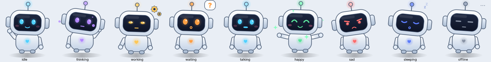
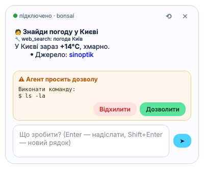

# 🤖 Kru

Власний автономний агент **Kru** на моделі **Qwen3.6-35B-A3B** (llama-server) і милий десктоп-персонаж
(робот або таксик), який живе поверх усіх вікон на Fedora та Windows.

```
┌──────────── Клієнт (Fedora / Windows) ──┐        ┌──────────────── Сервер ────────────────┐
│  🤖 kru-robot (PySide6)                  │  WS    │  kru serve (FastAPI)                   │
│  • завжди поверх вікон, анімації         │◀──────▶│  • цикл агента (LLM ↔ інструменти)     │
│  • клік → поле вводу задачі              │ token  │  • web_search / fetch_url (HTML, PDF)  │
│  • кнопки «Дозволити / Відхилити»        │        │  • файли, shell, Python, зображення    │
└──────────────────────────────────────────┘        │  • пам'ять (SQLite FTS5), чати         │
                                                    │           │                            │
   kru chat --server ws://… (CLI/REPL) ────────────▶│  Qwen3.6 у llama-server :8085 (Docker) │
                                                    └────────────────────────────────────────┘
```

## Можливості

| Інструмент | Що робить | Підтвердження |
|---|---|---|
| `web_search` | пошук в інтернеті (DuckDuckGo або власний SearXNG), режим новин | — |
| `fetch_url` | читає сторінку чи PDF як текст, з пагінацією | — |
| `read_file`, `list_dir`, `search_files` | читання та пошук по файлах у workspace | — |
| `write_file`, `edit_file` | створення та редагування файлів | ✅ |
| `run_shell` | команди bash у workspace (з таймаутом) | ✅ |
| `run_python` | виконання Python-коду (обчислення, аналіз даних) | ✅ |
| `remember`, `recall`, `forget` | довготривала пам'ять між сесіями | — |
| `current_datetime` | поточні дата й час | — |

- **Пам'ять.** Перед кожною задачею агент сам підтягує релевантні записи з пам'яті.
- **Чати зберігаються автоматично** на сервері — після кожного повідомлення і кожного кроку агента,
  тож збій чи раптове вимкнення ПК нічого не губить. Непотрібні чати можна видалити.
- **Кілька користувачів.** У кожного свій токен, а отже свої чати, пам'ять і робоча тека (див. [1.3](#13-користувачі)).
- **Безпека.** Небезпечні дії виконуються тільки після явного дозволу. Файлові операції обмежені робочою директорією `KRU_WORKSPACE`. Доступ до сервера захищений токеном.
- **Сумісність із моделлю.** Агент використовує нативні tool calls. Якщо модель їх не підтримує, він автоматично переходить на текстовий JSON-протокол (`KRU_TOOL_MODE=auto`).

## Робот-оболонка



Іконка програми — той самий робот (генерується інсталятором у всіх розмірах):


### Персонаж «Такса» 🐶

Замість робота можна вибрати милого таксика: **ПКМ → Налаштування → Персонаж**. Перемикається на льоту, разом
з іконкою в треї. Поведінка та сама, змінюється лише вигляд: вушка гойдаються з інерцією, хвіст виляє тим швидше,
чим радісніше таксику, при роботі він копає землю лапкою, просить дозволу піднятою лапкою, від гладження висолоплює
язика, а коли несеш на нього файл — чекає кісточку. Уві сні з носика надувається бульбашка.




- **Клік** відкриває або ховає поле вводу задачі: панель плавно виїжджає від робота, а «хвостик» вказує на нього. **Esc** ховає панель. **Enter** надсилає задачу, **Shift+Enter** переносить рядок.
- **Оновлення.** Після `./install_fedora.sh` достатньо знову запустити `kru-robot`: якщо вже працює стара версія,
  нова сама її закриє й запуститься замість неї.
- **Ctrl+Alt+B** (з будь-якого вікна) відкриває або ховає поле вводу. Інсталятор реєструє цю клавішу в KDE та GNOME.
  Також можна з терміналу: `kru-robot --toggle`, `kru-robot --ask "котра година?"`, `kru-robot --quit`.
- **Гладження.** Якщо повільно поводити курсором по голові, робот муркоче: заплющує очі, з'являються сердечка і «мрр~».
  Сплячий від цього прокидається.
- **Перетягни файл на робота** (txt, md, csv, json, код, PDF, DOCX, ODT, до 25 МБ). Файл передається на сервер у `uploads/`,
  а в полі вводу з'являється «Проаналізуй файл …:». Залишається дописати, що з ним зробити.
  Посилання чи виділений текст теж можна перетягнути.
- **💬 Чати.** Кожна розмова зберігається на сервері автоматично, як у ChatGPT чи Claude, — нічого натискати не треба.
  Кнопка з олівцем (або **Ctrl+N**) починає новий чат. Кнопка-тека відкриває сторінку **«Чати»** (усередині панелі),
  де поточний позначено ●: чат можна відкрити й продовжити, перейменувати, експортувати в Markdown або видалити
  (з підтвердженням). Назва за замовчуванням — перше повідомлення. Після перезапуску робот показує розмову,
  на якій ти зупинився. З тим самим токеном на іншому ПК видно ті самі чати.
  Експорт одразу зберігається в `~/Документи/Kru/`, а кнопки «Відкрити теку» й «Відкрити файл» з'являються в панелі.
  **Esc** закриває запит, повертає зі сторінки чатів або ховає панель.
- **Перетягування самого робота** переміщує його. Позиція запам'ятовується.
- **Права кнопка миші** відкриває меню: нова розмова, зупинити задачу, налаштування, сховати, вийти. Те саме меню є в треї.
- **Технічні рядки** дій агента («🔧 read_file: …») типово приховані — замість них у статусі видно «📖 Читаю файл…». Увімкнути: Налаштування → «Показувати дії агента».
- Очі стежать за курсором. Під час роздумів навколо голови обертаються точки, під час роботи крутяться шестерні. Коли агент чекає дозволу, над роботом з'являється «?». Якщо робот довго простоює, він засинає (Zzz).
- Подивитися всі анімації без сервера: `kru-robot --demo` (по колу, з підписами), один стан: `kru-robot --demo thinking`,
  таксика: `kru-robot --demo --character dog`.

---

## 1. Сервер

### 1.1 Модель — Qwen3.6-35B-A3B

Для RTX 3060 12 ГБ потрібно ще ≥32 ГБ RAM. Це модель із «експертами» (MoE): на кожен токен працює лише ~3B
параметрів, частина ваг живе у звичайній RAM (`--n-cpu-moe`), тому модель вміщується в 12 ГБ VRAM.
Конфіг — [`deploy/qwen36/docker-compose.yml`](deploy/qwen36/docker-compose.yml), офіційний образ llama.cpp,
порт `127.0.0.1:8085`, `--alias qwen3.6-35b-a3b`.

```bash
# модель ~22 ГБ, кладемо в ~/bot
curl -L -C - -o ~/bot/Qwen3.6-35B-A3B-UD-Q4_K_M.gguf \
  https://huggingface.co/unsloth/Qwen3.6-35B-A3B-GGUF/resolve/main/Qwen3.6-35B-A3B-UD-Q4_K_M.gguf

deploy/model.sh start     # запустити (далі піднімається сама після перезавантаження)
deploy/model.sh status    # що запущено, скільки VRAM
deploy/model.sh stop
```

> Порт моделі опублікований лише на `127.0.0.1`, тому агент працює на тій самій машині. Клієнтам він віддає
> WebSocket-порт 8765. Якщо модель ще вантажиться, агент скаже про це і підхопить її сам, без перезапуску.

**👁 Розуміння зображень.** Зір у Qwen3.6 вбудований, але у форматі GGUF його «очі» (візуальний кодувальник)
лежать в окремому файлі `mmproj` (~0.9 ГБ). Якщо він поруч із моделлю, compose вмикає зір сам і ставить
`--n-cpu-moe 30`, щоб звільнити VRAM:

```bash
curl -L -C - -o ~/bot/mmproj-Qwen3.6-35B-A3B-F16.gguf \
  https://huggingface.co/unsloth/Qwen3.6-35B-A3B-GGUF/resolve/main/mmproj-F16.gguf
deploy/model.sh start
```

Після цього можна перетягнути картинку на персонажа, вставити скриншот у поле вводу через **Ctrl+V** або
написати в задачі шлях до картинки у workspace — агент сам передасть зображення моделі. Інструментом `view_image`
він дивиться й на картинки, які знайде чи створить сам. Великі зображення зменшуються до 1568 пікселів.
Якщо зору немає, агент вимикає його сам (`KRU_VISION=auto|on|off`).

Як перевірити, що зір працює:
- **Статус у панелі** закінчується на «· 👁». Якщо там «· без зору», модель запущена без `mmproj`.
- **Напряму:** `curl -s 127.0.0.1:8085/props | grep -o '"vision":[a-z]*'` має повернути `"vision":true`.

Як підібрати `--n-cpu-moe` (типово 26, змінна `N_CPU_MOE`): менше значення працює швидше, але займає більше VRAM.
«out of memory» у лозі — збільш; `nvidia-smi` показує понад 1.5 ГБ вільної пам'яті — зменш на 2–4.
Міркування («thinking») увімкнені; для швидших відповідей розкоментуй `--chat-template-kwargs` у compose.

### 1.2 Агент

Як systemd-сервіс (автозапуск, логи в journald):

```bash
cd server && ./install_server.sh
journalctl --user -u kru -f
```

Конфіг лежить у `~/.config/kru.env`, там же згенерований токен. Усі параметри описані в
[`server/.env.example`](server/.env.example) (змінні `KRU_*`).

Вручну, для розробки:

```bash
cd server
python3 -m venv .venv && . .venv/bin/activate
pip install -e .
cp .env.example .env          # і задай KRU_TOKEN: openssl rand -hex 24
kru health                    # перевірка доступності моделі
kru serve                     # ws://0.0.0.0:8765/ws
```

### 1.3 Користувачі

Токен — це обліковий запис: з тим самим токеном на будь-якому ПК ти бачиш свої чати, пам'ять і файли.
Іншим людям створи окремих користувачів:

```bash
kru user add olena            # покаже токен один раз — передай його Олені
kru user add max --admin      # адміністратор: shell, Python, доступ до всього
kru user list
kru user revoke olena         # токен перестає працювати одразу, без перезапуску
```

- Твій `KRU_TOKEN` — це власник **owner** (admin); його чати, пам'ять і `KRU_WORKSPACE` лишаються як були.
- Кожен інший користувач працює у своїй теці `~/kru-users/<ім'я>/` (`KRU_USERS_WORKSPACE`) і бачить
  лише свої чати та спогади.
- Роль **user** не має `run_shell` і `run_python` (через них можна було б прочитати чужі дані на сервері)
  і не може вийти за межі своєї теки. Пошук, сторінки, файли у своїй теці, зображення й пам'ять — доступні.
- Токени зберігаються лише як SHA-256 у `<DATA_DIR>/users.json` (права 600).
- Модель одна на всіх: якщо двоє дають задачі одночасно, друга почекає першу.

> 🔒 Не відкривай порт 8765 в інтернет напряму. Використовуй локальну мережу, VPN (наприклад, Tailscale)
> або reverse-proxy з TLS (Caddy чи nginx). Тоді в клієнті адреса буде `wss://…`.

## 2. Клієнт на Fedora

```bash
cd client
./install_fedora.sh ws://IP_СЕРВЕРА:8765/ws ТОКЕН
kru-robot
```

Скрипт встановлює потрібні системні пакети (`xcb-util-cursor` тощо), створює venv з PySide6, лаунчер
`~/.local/bin/kru-robot`, пункт у меню та автозапуск при вході в систему. Видалення: `./uninstall_fedora.sh`.

**Чому робот працює через XWayland.** На Wayland (GNOME у Fedora) застосунок не може сам триматися
поверх усіх вікон і задавати свою позицію. Тому лаунчер запускає Qt з `QT_QPA_PLATFORM=xcb`. Якщо дуже
треба нативний Wayland, запусти так: `QT_QPA_PLATFORM=wayland kru-robot`. Але тоді «поверх усіх вікон»
залежить від композитора.

Налаштування клієнта зберігаються в `~/.config/kru-robot/config.json`. Їх також можна змінити через
ПКМ по роботу → Налаштування.

### Підключення через NetBird

Як адресу сервера в клієнті вказуй NetBird-IP або DNS-ім'я піра (обидва показує `netbird status`):
`ws://ІМ'Я.netbird.cloud:8765/ws`. Використовуй `ws://`, а не `wss://`: трафік уже шифрує WireGuard.
Порт 8765 варто відкрити лише для NetBird-мережі. Є два способи:
- прив'язати агента до NetBird-IP через `KRU_HOST=100.x.y.z`;
- закрити порт файрволом:
  `sudo firewall-cmd --permanent --add-rich-rule='rule family=ipv4 source address=100.64.0.0/10 port port=8765 protocol=tcp accept'`.

### Діагностика підключення

Статус у панелі робота пояснює причину помилки, а повний технічний текст показується, якщо навести курсор.

| Повідомлення | Що перевірити |
|---|---|
| сервер відхилив підключення — перевір токен | токен у клієнті ≠ `KRU_TOKEN` у `~/.config/kru.env` на сервері |
| сервер не відповідає на цьому порту | чи запущено агента (`systemctl --user status kru`), чи правильний порт |
| хост не знайдено / час очікування вичерпано | чи підключено NetBird на обох машинах, адреса, файрвол |
| помилка TLS | у адресі `wss://` замість `ws://` |

Перевірка з клієнта одною командою: `curl http://АДРЕСА:8765/health`. Вона показує, чи доступний агент і чи бачить він модель.

## 2б. Клієнт на Windows 10/11

Робот на Windows — той самий Kru з тими самими функціями. Він підключається до твого сервера з моделлю (через LAN
або NetBird); модель і інструменти працюють на сервері.

**Варіант 1 — інсталятор (потрібен лише інтернет):**
1. Скопіюй теку `client` з репозиторію на Windows-ПК (або `git clone`).
2. Двічі клацни `client\windows\install_windows.cmd`.

Скрипт сам:
- поставить Python 3.12 через winget, якщо його немає;
- створить окреме середовище в `%LOCALAPPDATA%\Kru`;
- намалює іконку;
- додасть ярлики в «Пуск» і на робочий стіл;
- увімкне автозапуск і запустить робота.

При першому запуску відкриються налаштування: вкажи `ws://IP_СЕРВЕРА:8765/ws` і токен. Сервер і токен можна задати
й одразу:
```powershell
powershell -ExecutionPolicy Bypass -File client\windows\install_windows.ps1 -Server ws://100.x.y.z:8765/ws -Token ТОКЕН
```
Видалення: `client\windows\uninstall_windows.cmd`.

**Варіант 2 — готовий `Kru.exe` (Python не потрібен).** GitHub Actions збирає його при кожному push:
на вкладці **Actions** відкрий останній запуск **CI** і завантаж артефакт **Kru-windows**. Розпакуй
архів куди завгодно й запусти `Kru.exe`. Автозапуск вмикається галочкою в налаштуваннях робота.

На Windows:
- **Ctrl+Alt+B** працює з будь-якої програми (реєструється через Windows API, без окремого процесу);
- автозапуск — галочка «Запускати разом із Windows» у налаштуваннях;
- налаштування лежать у `%APPDATA%\kru-robot\config.json`, експорт чатів — у `Документи\Kru`.

CI на кожен push запускає `--selftest` робота на справжній Windows-машині. Самоперевірка охоплює вікно, анімацію
панелі, вбудовані запити, історію, гарячу клавішу, автозапуск і мережевий модуль. Знімки екрана зберігаються в
артефактах.

## 3. CLI / REPL

```bash
kru chat                                            # локально (агент у цьому ж процесі)
kru chat --server ws://IP:8765/ws --token ТОКЕН     # через сервер
kru ask "знайди 3 свіжі новини про Fedora 43 і коротко перекажи"
kru chat --thinking                                 # показувати міркування моделі
kru chat --session ID                               # продовжити конкретний чат
```

Кожен запуск `kru chat` — новий чат; усі зберігаються автоматично. У REPL є команди `/new` (новий чат), `/chats`
(список з номерами), `/open N`, `/rename назва`, `/delete N`, `/export [файл.md]` і `/exit`. **Ctrl+C** скасовує поточну задачу.

## 4. API

**WebSocket** `ws://host:8765/ws?token=…` обмінюється JSON-повідомленнями. Повний опис протоколу є в
[`server/kru_agent/server.py`](server/kru_agent/server.py).

```jsonc
// клієнт → сервер
{"type": "task", "text": "…", "session_id": "default"}
{"type": "confirm_response", "id": "…", "approved": true}
{"type": "cancel"}
{"type": "chat_list"} | {"type": "chat_open", "id"} | {"type": "chat_rename", "id", "title"}
{"type": "chat_delete", "id"} | {"type": "chat_export", "id"}   // id чату = session_id
// сервер → клієнт
hello{user, role} | status | thinking | token | tool_call | tool_result | confirm_request | final | error | chat_*
```

**REST** `POST /api/task` з тілом `{"text": "...", "session_id": "api"}` і заголовком
`Authorization: Bearer ТОКЕН` виконує задачу неінтерактивно. Небезпечні дії при цьому відхиляються,
якщо не встановлено `KRU_AUTO_APPROVE=true`. Перевірка стану: `GET /health`.

## Оновлення

Сервер і робот встановлені у власні віртуальні середовища, тому самого `git pull` недостатньо.
На кожній Linux-машині (сервер, Fedora) просто запусти:

```bash
cd ~/bot && ./update.sh
```

Скрипт підтягне зміни, перевстановить те, що встановлено на цій машині (сервер і/або робота),
перезапустить сервіс `kru` і персонажа.
## Розробка

```bash
cd server && pip install -e '.[dev]' && pytest
```

Тести використовують фейкову LLM. Вони перевіряють цикл агента, відкат на JSON-протокол, інструменти,
пам'ять, пісочницю шляхів, парсинг стрімів Ollama та OpenAI і WebSocket-протокол із підтвердженнями.

```
server/kru_agent/
  agent.py      цикл агента, системний промпт, JSON-fallback
  llm.py        клієнти Ollama і OpenAI-сумісного API (стрімінг, tools, thinking)
  server.py     FastAPI + WebSocket
  cli.py        kru serve | chat | ask | health
  storage.py    SQLite: пам'ять (FTS5) і сесії
  tools/        web, files, shell, python_exec, memory, system
client/kru_robot/
  robot.py      малювання робота й анімації (QPainter)
  panel.py      спливаюча панель: ввід, стрічка, підтвердження
  app.py        вікно поверх усіх, меню, трей, обробка подій
  connection.py WebSocket з автоперепідключенням
```

### Як додати свій інструмент

Створи модуль у `server/kru_agent/tools/` зі списком `TOOLS = [Tool(name=…, description=…,
parameters={JSON Schema}, func=async_fn, dangerous=False)]` і додай модуль у `build_registry()`.
